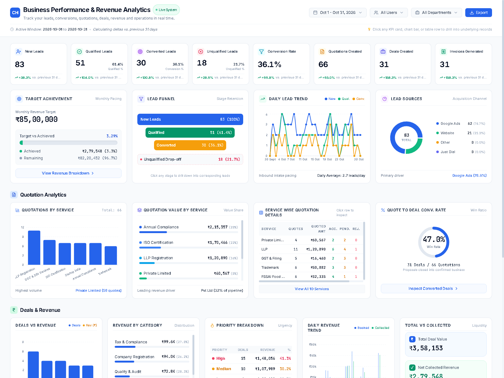

# Compliance Hub dashboard

A sales and revenue dashboard for a corporate compliance firm, the kind that handles
company registrations, GST filings and MCA paperwork. It shows where the leads are, which
quotations turned into deals, what has actually been collected, and who on the team is
doing what.

Built during my IBM virtual internship.

**[Open the live dashboard](https://internship-project-gamma-jet.vercel.app)**



## What's on it

Everything responds to one set of filters at the top: a date range, a specific team
member, and a department. Change any of them and the whole page recalculates.

Eight KPI tiles across the top cover new, qualified, converted and unqualified leads, the
conversion rate, and counts for quotations, deals and invoices. Each tile shows the change
against the previous period of the same length, so a number is never sitting there without
context.

Below that:

- **Lead analytics.** The funnel from new to converted, revenue against target, and the
  trend line over the period.
- **Quotation analytics.** Which of the compliance services actually sell, and what
  happens to quotations that don't close.
- **Deals and revenue.** The pipeline by stage, a priority matrix, and a cash flow view
  that separates collected money from outstanding receivables.
- **Operations and team.** Order status, per-person productivity, and a live feed of CRM
  activity.

## The drill-down

Clicking almost anything opens a side panel with the rows behind that number. The part I
spent the most time on is that the drill-downs stack: open the funnel, click a stage,
click a lead inside it, and you can walk back out one level at a time instead of losing
your place and starting over.

That is handled by a `drillDownStack` array in `DashboardContext`, which also owns the
filters and the memoised filtered datasets, so no component does its own filtering.

## About the data

The data in `src/data/mockData.ts` is made up. Real client and revenue figures were not
something I could publish, so the dataset is synthetic: a team, a service catalogue
with realistic prices and turnaround times, and leads, quotations, deals, orders and
payments generated across October 2026.

The filtering, the maths and the drill-downs all work on it exactly as they would on real
rows. Swapping in a real API means replacing that one file.

## Running it

```bash
npm install
npm run dev
```

`npm run build` type-checks with `tsc -b` before building, and `npm run lint` runs oxlint.

## Built with

React 19, TypeScript, Vite, Tailwind CSS, Recharts for the charts, and lucide-react for
the icons.
